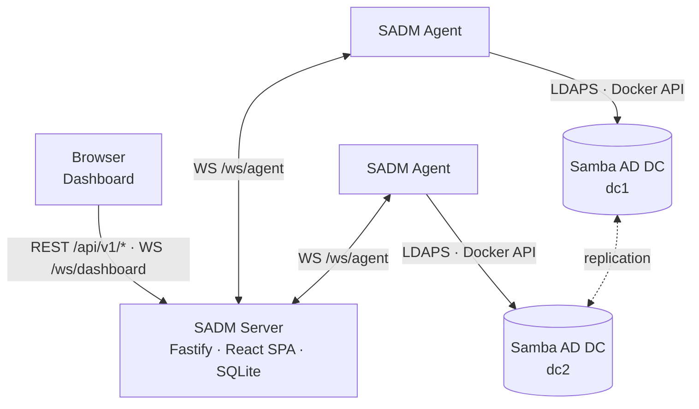

# Samba AD Manager (SADM)

An Active Directory run by Samba is managed on the command line: `samba-tool` on a domain
controller answers how replication is doing, who holds which role and what the database
check found — one domain controller at a time, as text. Users and groups are managed the
same way, or with Windows tools from a joined machine.

**SADM gives such a domain one dashboard.** A small agent runs next to each domain
controller; a central server collects what the agents measure, shows the domain as a whole
and names what is wrong. The same agents read and change the directory's objects — users,
groups, computers and organizational units.

## How the pieces fit together

| | What it holds | Talks to |
|---|---|---|
| **SADM server** | Accounts, the registered agents, the last measurement of every domain controller, the activity history, webhooks and settings — in SQLite | the browser, the agents |
| **SADM agent** | Its identity and the activity events not yet acknowledged — in its own data directory | the SADM server, its domain controller |
| **Samba AD DC** | The directory | the agent: LDAPS, and the Docker API of its host |

The server never talks to a domain controller itself. Whatever it shows or changes goes
through an agent, which implements a fixed list of actions and nothing else.

## Where the data comes from

Nothing SADM shows is read out of the text a command prints. Each fact comes from the source
that has it in structured form:

| What | Source |
|---|---|
| Users, groups, computers, organizational units — reading and changing | LDAPS |
| Who the domain controller is, its Samba version, the functional levels | LDAP rootDSE |
| The holders of the seven FSMO roles, the domain controllers of the forest | LDAP |
| The state of the Samba container | Docker API |
| Replication neighbours, service processes, the database check | Samba's own Python modules, run inside the Samba container |

## Where to go next

- [Quick Start](quickstart.md) — a server and the first agent with Docker Compose
- [Configuration](configuration.md) — both `config.yaml` files and the environment variables
- [Domain Health](health.md) — what is measured and what counts as a finding
- [Directory](directory.md) — what can be managed, and what is protected
- [Webhooks](webhooks.md) — reporting findings and changes elsewhere
- [Security](security.md) — what the agent may do, and how to limit it
- [Development](development.md) — the development stack with its test domain
