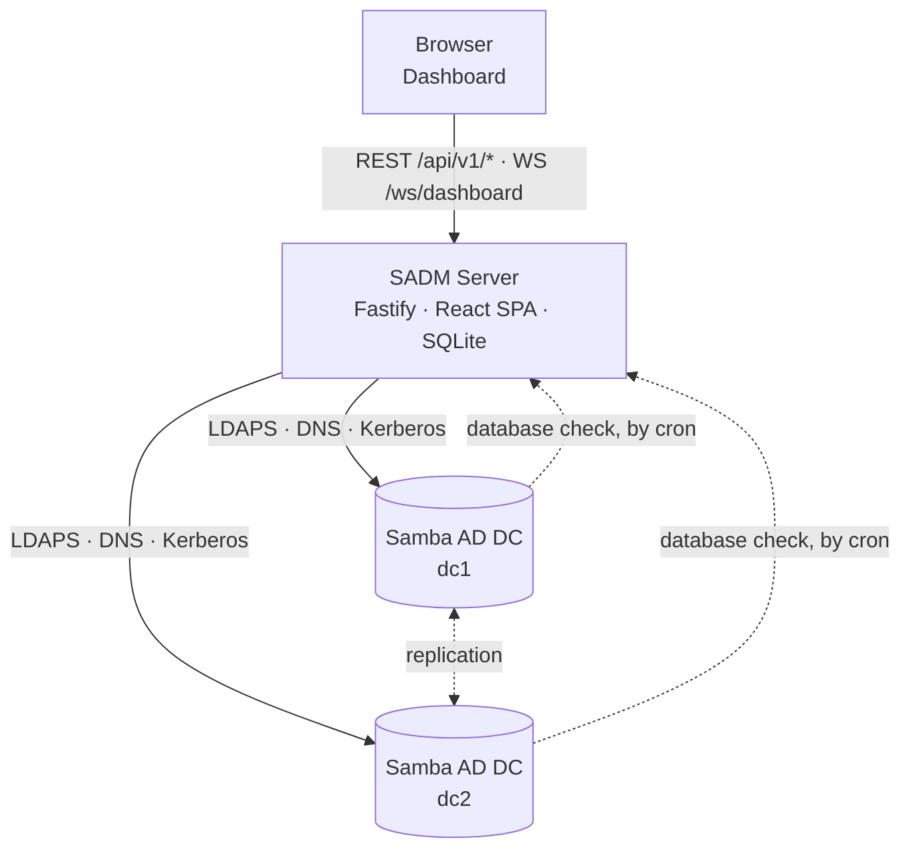

# Samba AD Manager (SADM)

An Active Directory run by Samba is managed on the command line: `samba-tool` on a domain
controller answers how replication is doing, who holds which role and what the database
check found — one domain controller at a time, as text. Users and groups are managed the
same way, or with Windows tools from a joined machine.

**SADM gives such a domain one dashboard.** One server asks the domain who its domain
controllers are, measures each of them over the network, shows the domain as a whole and
names what is wrong. The same server reads and changes the directory's objects — users,
groups, computers and organizational units. Nothing is installed on a domain controller.

## How the pieces fit together

| | What it holds | Talks to |
|---|---|---|
| **SADM server** | Accounts, the domain controllers the directory lists, the last measurement of each, the activity history, webhooks and settings — in SQLite | the browser, every domain controller |
| **Samba AD DC** | The directory | the server: it is asked over LDAPS, DNS and Kerberos |

The server is told where one domain controller is and as whom to ask. Every other domain
controller it finds in the directory — one that joins the domain is measured from the next
minute on, and one that is demoted disappears.

## Where the data comes from

Nothing SADM shows is read out of the text a command prints. Each fact comes from the source
that has it in structured form:

| What | Source |
|---|---|
| Users, groups, computers, organizational units — reading and changing | LDAPS |
| Who the domain controller is, its Samba version, its clock | LDAP rootDSE |
| The functional levels, the holders of the seven FSMO roles, the domain controllers of the forest | LDAP |
| Replication, per naming context | the `repsFrom` and `repsTo` attributes, over LDAPS |
| Whether a service answers | a question in its own protocol: LDAP, DNS, Kerberos; for the others, whether the port opens |
| The database check | Samba's own checker, run on the domain controller by cron and [reported to the server](dbcheck.md) |

## Where to go next

- [Quick Start](quickstart.md) — the server with Docker Compose, pointed at a domain
- [Configuration](configuration.md) — `config.yaml` and the environment variables
- [Domain Health](health.md) — what is measured and what counts as a finding
- [Database Check](dbcheck.md) — the one measurement a domain controller reports itself
- [Directory](directory.md) — what can be managed, and what is protected
- [Webhooks](webhooks.md) — reporting findings and changes elsewhere
- [Security](security.md) — what the server can do, and what limits it
- [Development](development.md) — the development stack with its test domain
